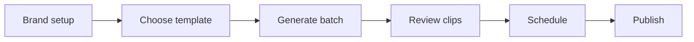

# Otonom Media - Product Requirements Document

**Document Version:** 2.0  
**Last Updated:** 2026-05-26  
**Status:** Active Development  
**Primary Product:** Guided Studio OS for HyperFrames-first media production

---

## 1. Summary

Otonom Media is a local-first media production system for turning long-form video sources into short-form and landscape clips. The product is now centered on a guided dashboard experience, not a CLI-first or niche-specific workflow.

The current direction is:

- **Guided Studio OS** as the main operator UI.
- **HyperFrames-first rendering** for template-driven video output.
- **Template-first generation** so users choose a visual format before creating a batch.
- **Public, multi-brand readiness** with generic templates and reusable Brand System Templates.
- **Human review and publishing guardrails** before scheduling or publishing.

Remotion remains as hidden legacy fallback for old jobs. It is not presented as a normal user-facing renderer.

---

## 2. Product Goals

| Goal | Description |
|---|---|
| Make the first action obvious | The Home screen should show one Next Best Action based on current pipeline state. |
| Make generation template-first | Users choose or confirm a video template before source, genre, duration, and output options. |
| Make HyperFrames the primary renderer | Built-in and brand templates render through HyperFrames when runtime is enabled. |
| Support public multi-brand usage | No user-facing template naming should depend on a private brand or persona. |
| Keep advanced controls secondary | Editing, preview, repair, and brand customization should live in modals or collapsed sections. |
| Preserve local-first operation | SQLite, local files, and local runtime checks remain the default operating model. |

---

## 3. Target Users

### Primary

- Solo media operators creating short-form clips from long videos.
- Small content teams that need review, approval, scheduling, and multi-platform publishing.
- Creators or agencies that want reusable video brand systems without raw-code editing.

### Secondary

- Developers extending render templates, platform connectors, and automation policies.
- Power users running batch jobs from CLI for local production workflows.

---

## 4. Core Workflow



The app should guide the user through this pipeline with state-aware copy and actions:

- `Choose a video template`
- `Generate first batch`
- `Review clips`
- `Schedule approved clips`
- `Connect channels`
- `Generate next batch`

---

## 5. Information Architecture

| Section | Purpose |
|---|---|
| Home | Command Center with Next Best Action, pipeline status, current batch, review queue, channel readiness, and recent output. |
| Create | Template-first generation flow with minimal fields and collapsed advanced engine settings. |
| Templates | Browse built-in, official-derived, and saved Brand System Templates with real-usecase previews. |
| Review | Queue-first review surface; clip preview and repair tools open in a modal. |
| Schedule | Approved clips and calendar/publish slots. |
| Channels | Platform readiness, publish targets, defaults, and latest publish attempts. |
| Brand | Brand System library and modal builder for reusable HyperFrames template customization. |

---

## 6. Functional Requirements

### 6.1 Guided Studio OS

| Requirement | Priority |
|---|---|
| Home derives a single Next Best Action from current jobs, clips, schedule, channels, templates, and engine health. | P0 |
| Sidebar uses workflow navigation: Home, Create, Templates, Review, Schedule, Channels, Brand. | P0 |
| Global metrics should not dominate every page. Page content should focus on the active workflow step. | P0 |
| Heavy preview/editor surfaces should open in focus modals. | P0 |
| Desktop and mobile layouts must remain usable without overlapping controls. | P0 |

### 6.2 Template-First Create Flow

| Requirement | Priority |
|---|---|
| Generate flow starts with template selection. | P0 |
| User can select built-in production templates, official HyperFrames-derived templates, saved Brand System Templates, or auto suggestion. | P0 |
| Payload includes `renderer`, `hyperframes_template`, `brand_system_template_id`, and `hyperframes_format`. | P0 |
| HyperFrames is the default renderer in UI/API/CLI. | P0 |
| Remotion is hidden from normal UI selection and remains legacy fallback only. | P0 |
| Advanced engine settings are collapsed by default. | P1 |

### 6.3 Templates

| Requirement | Priority |
|---|---|
| `GET /api/hyperframes-templates` returns built-in, official-derived, and saved brand templates. | P0 |
| Templates page provides browse cards with fixed 15s real-usecase preview. | P0 |
| Preview supports `Short 9:16` and `Long 16:9` switching. | P0 |
| Preview plays on hover and keeps the selected aspect ratio. | P0 |
| Clicking a template opens a detail modal with preview, purpose, supported formats, readiness, and actions. | P0 |
| Technical ingredients are available but secondary/collapsed. | P1 |

### 6.4 Brand System

| Requirement | Priority |
|---|---|
| Brand page acts as a preset/library surface, not a dense form-first editor. | P0 |
| Brand Builder opens in a modal. | P0 |
| Customization is slot-based: captions, typography, colors, logo/watermark, hook layout, lower-third/CTA, texture/effects, transitions, and optional data/map/product overlays. | P0 |
| Saved Brand System Templates can be reused in Create. | P0 |
| Raw HyperFrames code editing is not exposed in the default production UI. | P1 |

### 6.5 Review

| Requirement | Priority |
|---|---|
| Review page is queue-first. | P0 |
| Clicking a clip opens a Clip Preview Modal. | P0 |
| Modal supports preview, summary, readiness, approval, scheduling, and repair tabs. | P0 |
| Repair tabs preserve metadata, timing, captions, post copy, and QA workflows. | P0 |
| Inline desktop inspector/editor should not be the default surface. | P0 |

### 6.6 Rendering

| Requirement | Priority |
|---|---|
| HyperFrames renderer builds HTML/GSAP compositions from curated template metadata. | P0 |
| Renderer stores metadata including template id, template version, effects used, lint output, and inspect output. | P0 |
| Preview generation supports synthetic 15s previews for short and long formats. | P0 |
| FFmpeg remains available for trimming, encoding, audio normalization, and fallback utility work. | P0 |
| Legacy render paths continue to support old jobs where needed. | P1 |

### 6.7 Publishing and Guardrails

| Requirement | Priority |
|---|---|
| Publishing requires approved clips and configured targets. | P0 |
| Rights and platform readiness should block unsafe auto-publish states. | P0 |
| Latest publish attempts should be visible in Channels. | P0 |
| Schedule and publish workflows should remain compact and action-oriented. | P1 |

---

## 7. HyperFrames Template System

### Built-In Production Templates

- `spiritual_reflective`
- `podcast_talking_head`
- `data_market_explainer`
- `news_geo_brief`
- `product_brand_promo`

### Official-Derived Templates

- `warm_grain_editorial`
- `play_mode_social`
- `swiss_grid_explainer`
- `vignelli_portrait_headline`
- `decision_tree_tutorial`
- `kinetic_type_promo`
- `product_promo_showcase`
- `nyt_graph_data_story`

### Safety Model

HyperFrames catalog items are treated as a capability library. Components, blocks, effects, animations, and transitions should have quality status:

- `Production-ready`: allowed in normal renders.
- `Beta`: available with warning.
- `Experimental`: preview/sandbox only, not default for production.

This is a quality gate, not a closed registry. The goal is stable production output while still allowing controlled exploration.

---

## 8. Public Interfaces

### Frontend/API

| Interface | Purpose |
|---|---|
| `GET /api/hyperframes-templates` | Returns built-in, official-derived, and saved brand templates. |
| `GET /api/hyperframes-catalog` | Returns catalog capabilities and quality status. |
| `POST /api/brand-system-templates` | Saves a slot-based custom Brand System Template. |
| `POST /api/generation-jobs` | Starts generation with HyperFrames template and output format fields. |
| `GET /api/engine-health` | Reports renderer/runtime readiness. |

### Generation Payload Fields

```json
{
  "renderer": "hyperframes",
  "hyperframes_template": "auto",
  "brand_system_template_id": "",
  "hyperframes_format": "short_9_16"
}
```

Valid `hyperframes_format` values:

- `auto`
- `short_9_16`
- `long_16_9`

---

## 9. Architecture

```text
otonom-agents-media/
├── apps/dashboard/
│   └── src/components/
│       ├── MediaStudioApp.tsx
│       ├── home/
│       ├── generate/
│       ├── templates/
│       ├── review/
│       ├── calendar/
│       ├── channels/
│       ├── brand/
│       └── shared/
├── media-engine/
│   ├── media_engine/
│   │   ├── generation_jobs.py
│   │   ├── hyperframes_templates.py
│   │   ├── hyperframes_catalog.py
│   │   ├── hyperframes_previews.py
│   │   ├── hyperframes_renderer.py
│   │   ├── rendering.py
│   │   ├── review_server.py
│   │   ├── youtube_pipeline.py
│   │   ├── post_copy.py
│   │   └── db.py
│   ├── profiles/
│   │   └── default_workspace_style.json
│   └── render/hyperframes/
└── scripts/
    ├── dev.sh
    ├── pm2_common.sh
    └── run_publish_worker_pm2.sh
```

---

## 10. Non-Functional Requirements

| Category | Requirement |
|---|---|
| Local-first | App should run locally with dashboard, Python media engine, SQLite, FFmpeg, and optional HyperFrames runtime. |
| Public-ready naming | User-facing labels must avoid private/persona-specific names. |
| Stability | Production templates should pass lint/inspect/render smoke checks before being promoted. |
| Recoverability | Failed jobs should expose clear runtime log and retry/rerender actions. |
| Security | Credentials stay in ignored env files; no tokens or generated secrets committed. |
| Accessibility | Modals support close button, Esc, overlay close, focus management, and internal scroll. |
| Performance | Template previews should lazy-load and play on hover to reduce initial page load. |

---

## 11. CLI Requirements

Core commands should support HyperFrames fields:

```bash
python -m media_engine.cli premium-batch \
  --youtube-url "<url>" \
  --count 5 \
  --renderer hyperframes \
  --hyperframes-template auto \
  --hyperframes-format short_9_16

python -m media_engine.cli hyperframes-previews --status
python -m media_engine.cli hyperframes-previews
```

Legacy commands may remain for compatibility, but new production flows should prefer `renderer=hyperframes`.

---

## 12. Current Test Plan

### Frontend

- `npm run lint`
- `npm run build`
- Browser QA for:
  - Home Next Best Action
  - Create template-first flow
  - Templates aspect switch and hover preview
  - Review clip modal
  - Brand builder modal
  - Channels readiness/actions

### Backend

- Template selection unit tests.
- Brand template save/load tests.
- Catalog status gating tests.
- HyperFrames preview status tests.
- Rendering contract tests for:
  - muted video track
  - separate audio track
  - registered paused GSAP timeline
  - no same-track overlap
  - render metadata includes template/brand/effects/lint/inspect data

---

## 13. Success Metrics

| Metric | Target |
|---|---|
| First-action clarity | New user can identify the next step within 10 seconds. |
| Generation setup time | User can start a batch in under 60 seconds after opening Create. |
| Template readiness | All production templates expose short and long previews. |
| Render success rate | >95% for HyperFrames production templates on validated runtime. |
| Review throughput | Operator can approve/schedule clips without opening terminal logs. |
| Public-readiness | No user-facing template names depend on private brand/persona naming. |

---

## 14. Roadmap

### Phase 1 - HyperFrames Guided Studio OS

- [x] HyperFrames template metadata and renderer integration
- [x] Guided dashboard shell
- [x] Template-first Create page
- [x] Templates browse surface with aspect switch
- [x] Modal-first preview/editor pattern
- [x] Brand System builder surface
- [x] HyperFrames default renderer in UI/API/CLI

### Phase 2 - Production Hardening

- [ ] Full smoke render set for all templates and both aspect ratios
- [ ] Stronger catalog status governance
- [ ] Better error messages for missing HyperFrames/FFmpeg/runtime dependencies
- [ ] Publish target test actions for each channel
- [ ] Review queue bulk actions

### Phase 3 - Public Multi-Brand Readiness

- [ ] Onboarding flow for a new workspace/brand
- [ ] Import/export Brand System Templates
- [ ] Multi-workspace storage model
- [ ] Optional cloud deployment architecture
- [ ] Team review/collaboration model

---

## 15. Open Decisions

| Decision | Current Position |
|---|---|
| SaaS deployment | Future; local-first remains primary. |
| User-installed arbitrary HyperFrames registry items | Not default production behavior; catalog is browsable, production use is quality-gated. |
| Remotion removal | Keep hidden legacy fallback until old jobs no longer need it. |
| Full video preview on Templates page | Use fixed 15s real-usecase preview, hover-triggered. |
| Public template naming | Generic names only. Avoid private media/persona names in UI. |
